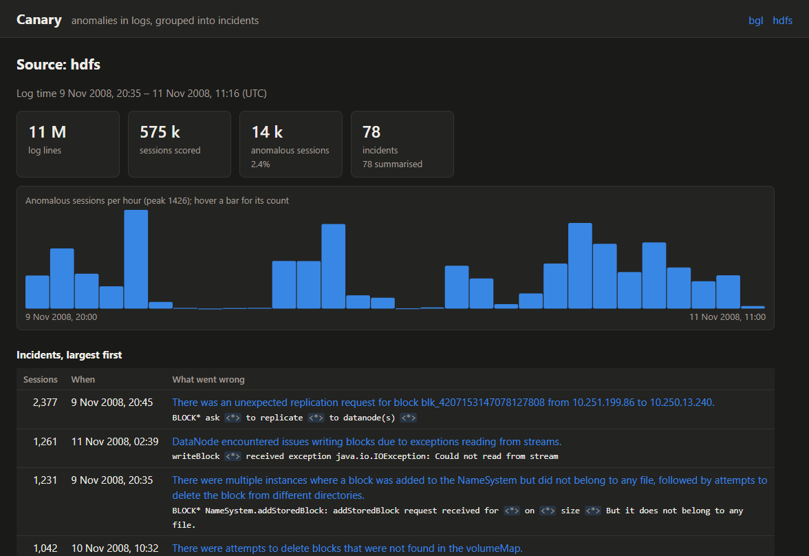
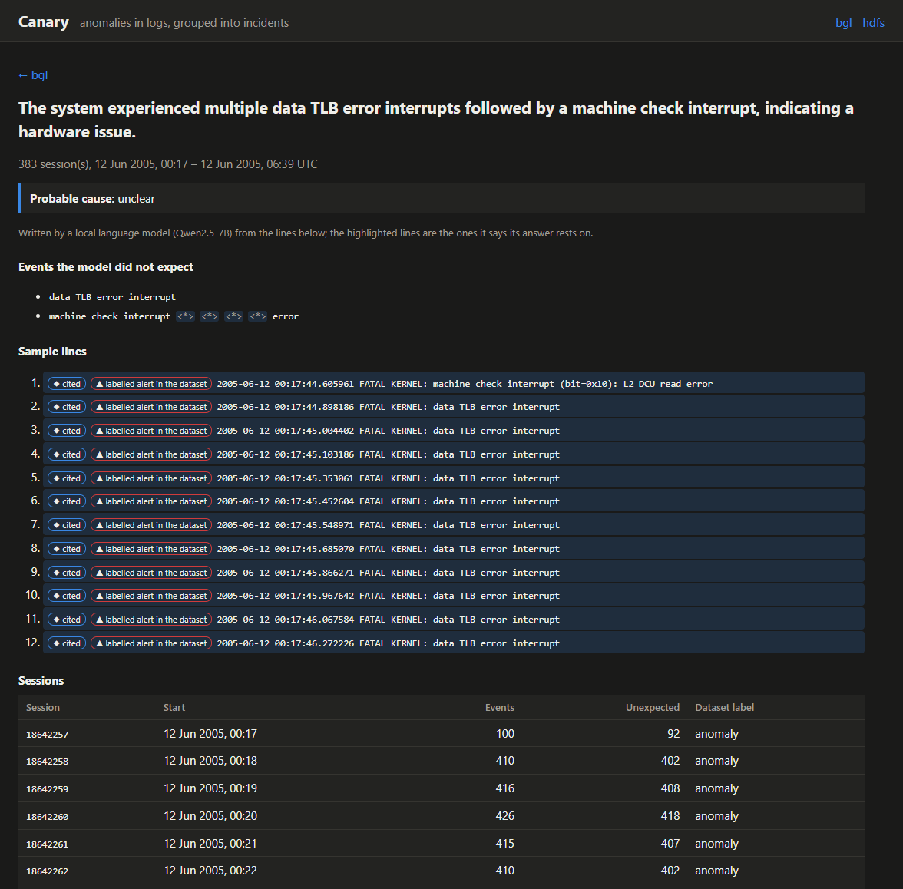

# Canary

Canary watches application logs for anomalies. It turns log lines into event templates, scores each session against a model of normal behaviour, groups the anomalous sessions into incidents, and has a local language model write a probable-cause summary for each incident. Every step is measured on the labelled [LogHub](https://github.com/logpai/loghub) datasets HDFS and BGL.



```
log files ──▶ agent (Rust) ──▶ collector (Go) ──▶ ClickHouse ──▶ detector (Python) ──▶ incidents ──▶ dashboard (TypeScript)
              parse, batch,     queue, batch,      logs, scores,   Drain templates,     language model:
              retry, resume     backpressure       incidents       DeepLog, grouping    summary and cited lines
```

| Part | Language | What it does |
|---|---|---|
| `agent/` | Rust | Follows log files like `tail -F` (rotation and truncation included) and parses each line's header. Ships newline-delimited JSON in batches, retries what the collector refuses, and saves its file offset only after a batch is accepted, so a restart loses nothing. |
| `collector/` | Go | Takes batches over HTTP into a bounded in-memory queue: a batch goes in whole or is refused with `429 Retry-After`. Writes to ClickHouse in large batches. When ClickHouse is slow or down, the queue fills up and the agents are told to wait, so no line is dropped. |
| `db/` | ClickHouse | Log lines, templates, scored sessions and incidents. |
| `detector/` | Python | Drain template mining, the anomaly models, the live detector, the summaries, and every evaluation. |
| `dashboard/` | TypeScript | Sources, anomalies over time, and incidents with their summaries and the log lines behind them. |

## How detection works

1. **Templates.**
   - Drain ([He et al., ICWS 2017](https://doi.org/10.1109/ICWS.2017.13)), implemented here, turns every message into a template, for example `Receiving block <*> src: /<*> dest: /<*>`. It learns online, so each line is placed using only the lines before it, exactly as in live use.
   - The trained Drain state is saved, so the live detector numbers templates the way training did.
2. **Sessions.**
   - HDFS: a session is a block. The detector scores a block after 13 hours of log time without activity: in the training period, 99.9% of blocks never went quiet for longer (deletions come hours after writes).
   - BGL: a session is one minute of the whole system's log.
3. **Scoring.** DeepLog ([Du et al., CCS 2017](https://doi.org/10.1145/3133956.3134015)) is an LSTM trained on normal sessions to predict the next template from the previous ten. An event the model did not rank in its top *k* is unexpected, and a session with at least *m* unexpected events is anomalous. *k* and *m* are chosen on validation data. Templates seen fewer than 5 times in training share one "rare" token, so a template the model has never seen is not an alarm by itself.
4. **Incidents.** Anomalous sessions whose most frequent unexpected template is the same, and that come within an hour of each other, form one incident.
5. **Summaries.**
   - Qwen2.5-7B-Instruct, running locally in llama.cpp, reads the incident's unexpected templates and up to twelve numbered sample lines.
   - It answers in JSON, held to a schema: a summary, a probable cause, and the numbers of the lines it relies on.
   - Line numbers that do not exist are dropped. An answer citing no real line is marked unsupported instead of being shown as a finding.



## Results

All results come from the scripts named, run on the full datasets. The JSON outputs are in `results/`.

### Template mining

Drain against the hand-made templates of LogHub-2k, 2,000 lines per system (`python -m canary.evaluate_parsing`):

| | True templates | Found | Grouping accuracy | Published for Drain (Zhu et al., 2019) |
|---|---|---|---|---|
| HDFS | 14 | 17 | **0.9975** | 0.998 |
| BGL | 120 | 109 | **0.964** | 0.963 |

On the full logs, Drain finds 48 templates in HDFS's 11.2 M lines and 1,862 in BGL's 4.7 M lines.

### Anomaly detection, with a chronological split

**Why a chronological split.** Sessions are ordered by start time and the most recent 20% are the test set. A random split lets a model learn from sessions that come after the ones it is tested on, which inflates results ([Le and Zhang, ICSE 2022](https://doi.org/10.1145/3510003.3510155)).

**How thresholds were chosen.** Each model's threshold, or *k* and *m*, is chosen on a random 15% of the earlier period. Validation was first one stretch of time just before the test, but BGL's anomalies come in bursts: that stretch held 19 anomalies in 2,214 windows, against 7% in the test.

**What the models see.** The unsupervised and semi-supervised models use validation labels only to set their threshold. DeepLog also uses training labels to keep only normal sessions.

Source: `python -m canary.evaluate HDFS|BGL`.

| Model | HDFS precision | recall | **F1** | BGL precision | recall | **F1** |
|---|---|---|---|---|---|---|
| Isolation Forest on template counts (unsupervised) | 0.339 | 0.818 | 0.480 | 0.977 | 0.218 | 0.357 |
| DeepLog LSTM (trained on normal sessions) | 0.637 | 0.660 | **0.648** | 0.280 | 0.831 | **0.419** |
| Logistic regression on template counts (supervised, a reference) | 0.999 | 0.939 | 0.968 | 0.891 | 0.426 | 0.576 |

Test sets: HDFS has 115,013 blocks (1.5% anomalous); BGL has 5,534 windows (7.0% anomalous).

These numbers are much lower than the 0.9+ F1 often reported for DeepLog on HDFS. Those results come from random splits or from training on the first 1% of sessions. Here the model meets later sessions that behave differently from the ones it trained on. The effect is stronger on BGL: 58% of its test windows contain a template that never appeared in training, and only 10% of those windows are anomalous.

A supervised model that has seen labelled anomalies does far better on HDFS. Without such labels, DeepLog is the best of the two unsupervised approaches on both systems.

### The live pipeline

- **Throughput.** The whole of HDFS (11.2 M lines) and BGL (4.7 M lines) went through agent → collector → ClickHouse at about 200,000 lines a second, with no batch refused or retried. The live detector processed HDFS in 5½ minutes and BGL in under 2 minutes, including Drain, the session store and the GPU model.
- **Agreement with the offline evaluation** (`python -m canary.evaluate_live`). On the 115,013 HDFS test blocks, the live verdicts are identical to the offline model's on every block: precision 0.637, recall 0.660, F1 0.648.
- **What made them match.** A first run used a 30-minute idle timeout. It cut 17,400 blocks into parts and raised 17,603 false alarms. The timeout is now derived from the training period, as described above.

### The summaries

**What is measured.** BGL labels every line, so it is possible to check whether the language model cites the right lines. The check covers the 76 incidents whose samples include both alert and normal lines. Source: `python -m canary.evaluate_summaries`.

| | |
|---|---|
| Share of cited lines that are alerts | **0.656** |
| The same share for lines cited at random | 0.48 |
| Share of the alert lines that are cited | 0.936 |
| Answers citing no line at all, of 299 | 4 |

**What this shows.** The model points at the alerts better than chance and misses few of them, but it cites too much: about two-thirds of the sample lines per incident. Its summaries name the right subsystem more often than not, for example data TLB errors followed by machine checks. Some say nothing: for one incident of 29 sessions, the summary reads "No unexpected events were detected in the provided log lines." Treat a summary as a starting point to read the cited lines from, not as a diagnosis.

## Running it

What you need:

- Docker, for ClickHouse;
- Rust, Go 1.27, Python 3.14 and Node 24;
- an NVIDIA GPU, optional but much faster for training.

```bash
scripts/fetch-data.sh                                   # HDFS and BGL from Zenodo, LogHub-2k
docker compose up -d --wait                             # ClickHouse on 127.0.0.1:8124
cd detector && python -m venv .venv && .venv/Scripts/pip install -r requirements.txt --index-url https://download.pytorch.org/whl/cu128 --extra-index-url https://pypi.org/simple
.venv/Scripts/python -m canary.prepare HDFS && .venv/Scripts/python -m canary.evaluate HDFS      # trains models/ (they are also in the repository)
cd ../collector && go run ./cmd/collector &
cd ../agent && cargo run --release -- --file ../data/raw/HDFS_v1/HDFS.log --format hdfs --source hdfs
cd ../detector && .venv/Scripts/python -m canary.live --source hdfs --dataset HDFS
.venv/Scripts/python -m canary.summarize --source hdfs  # needs llama-server with Qwen2.5-7B on port 8095
cd ../dashboard && npm install && npm run build && npm start                                      # http://localhost:3030
```

For a real service, point the agent at its log with `--follow`, and run `canary.live --follow`.

**Limits.**
- The agent knows the HDFS and BGL formats; another format needs a parser in `agent/src/format.rs` and `detector/canary/logformat.py`.
- The detector handles one source per process.
- Incident grouping by the top unexpected template still splits BGL into 925 incidents over seven months.

## Tests

| Part | Tests | What they cover |
|---|---|---|
| Rust | 6 | parsing, against the same fixture as Python; dates; following growing and rotated files; resending a refused batch |
| Go | 5 | the all-or-nothing queue; ordered writes after a failed one; refusing a malformed batch whole; 429 when the database stalls |
| Python | 7 | the format fixture; Drain generalising, matching and saving; grouping accuracy; the split; DeepLog flagging a broken sequence |
| TypeScript | 4 | the dashboard's formatting and chart geometry |

CI also runs an **integration job**: a ClickHouse service, the collector, the agent shipping LogHub's 2,000-line HDFS sample, and the live detector with the trained models.

## Licences

| What | Licence |
|---|---|
| Canary | MIT |
| [LogHub](https://github.com/logpai/loghub) datasets | Free for research. Not redistributed here: `scripts/fetch-data.sh` downloads them. Cite: Jieming Zhu, Shilin He, Pinjia He, Jinyang Liu, Michael R. Lyu, "Loghub: A Large Collection of System Log Datasets for AI-driven Log Analytics", ISSRE 2023. |
| Qwen2.5-7B-Instruct | Apache 2.0 |
| llama.cpp | MIT |
| ClickHouse | Apache 2.0 |

The trained models in `models/` are small (1.1 MB) and derived from the LogHub logs.
